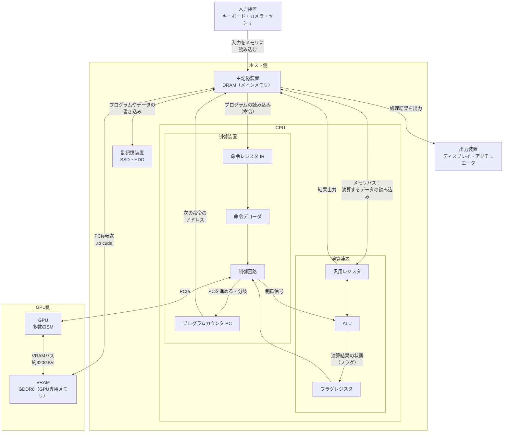
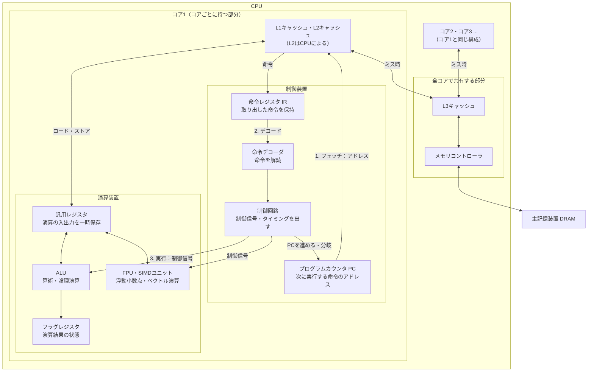
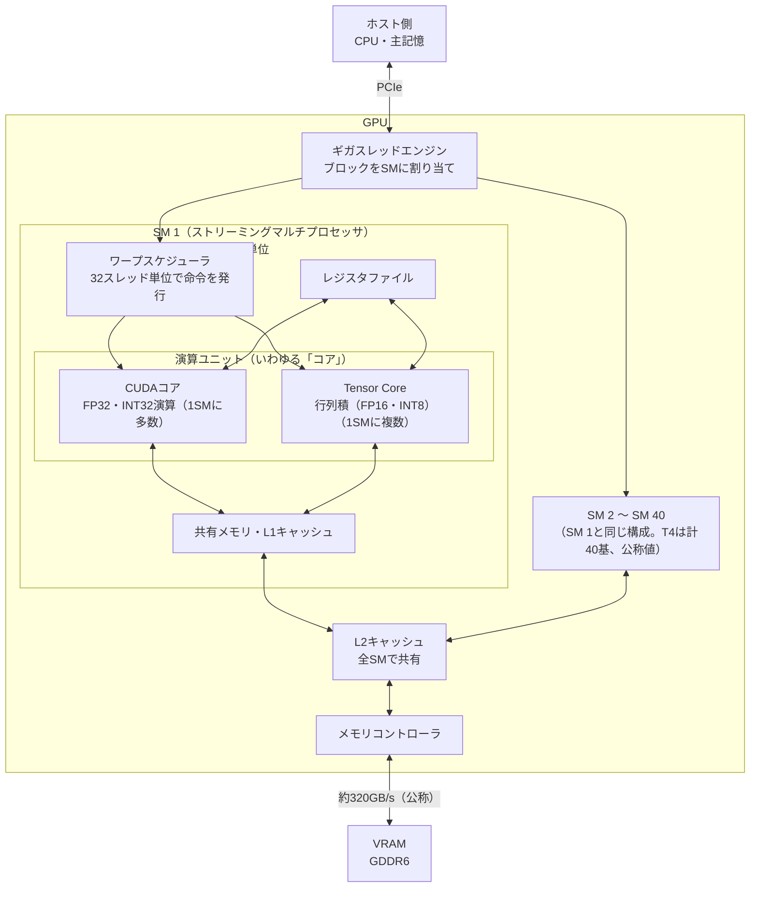
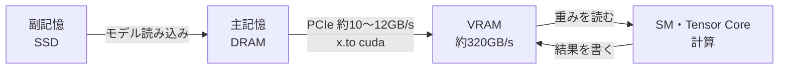
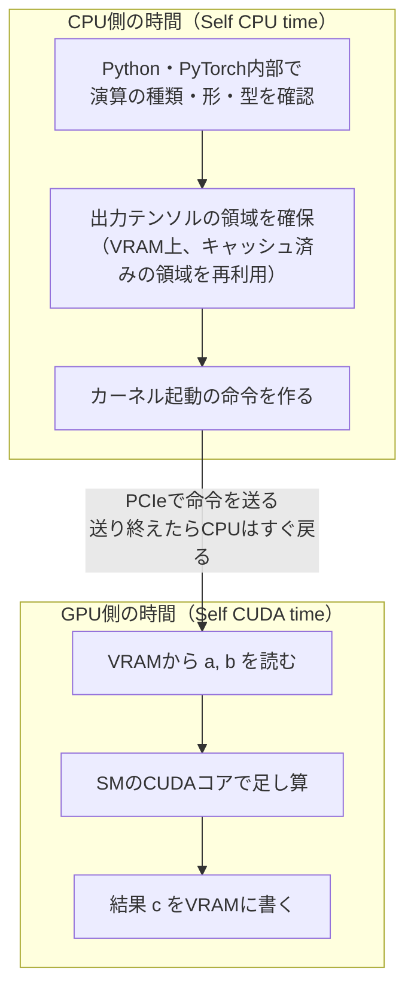

# コンピューターアーキテクチャ図解メモ（CPU・主記憶・GPU・VRAM）

図は Mermaid で書いている（GitHub、VS Code の Markdown プレビュー（拡張機能）で表示できる）。
各図の下に「メモ欄」の表を置いたので、調べたこと・自分の計測結果を書き足していく。

- 数値は公称値や一般的な値で、実測ではない。自分の計測値は「メモ」欄に書く
- T4の仕様は、NVIDIA公式のデータシートで確認すること

---

## 1. 全体図（5大装置 ＋ GPU・VRAM）

### メモ欄：全体

| 要素 | 役割 | このプロジェクトとの関連 | メモ（自由記入） |
|---|---|---|---|
| 入力装置 | 外部からデータを取り込む | カメラ画像（自動運転の例では6台） | |
| 出力装置 | 結果を外部に出す | 制御出力（関節角／軌道の座標列） | |
| 主記憶装置（DRAM） | 実行中のプログラムとデータを置く | CPU側のテンソルは、ここにある | colabで出てくるRAMとはここのこと |
| 副記憶装置（SSD・HDD） | 電源を切っても残る、大容量の保存先 | モデルの重みファイルの置き場 | AWSのEBSがこれにあたる（広域にはS3やマウントしたgoogle driveも） |
| CPU | 命令を実行する（図2） | 前処理、GPUへの命令の発行（カーネル起動） | |
| GPU | 大量の並列演算を行う（図3） | 推論の計算本体 | |
| VRAM | GPU専用の高速メモリ | 重みを読む速さが、bs=1の下限を決める（Day1） | NVIDIAのカタログなどでててくる「メモリ」がこれにあたる |
| PCIe | CPU側とGPU側をつなぐバス | `x.to("cuda")` の転送。実測：FP32 0.245ms、FP16 0.111ms | |

---

## 2. CPUの内部

### 命令サイクル（フェッチ → デコード → 実行 → 書き戻し）

1. **フェッチ**：PCが指すアドレスの命令を、メモリ（キャッシュ）から取り出し、IRに入れる
2. **デコード**：命令デコーダが、命令の中身（何をするか、どのレジスタを使うか）を解読する
3. **実行**：制御回路の信号で、ALUやFPUが演算する。必要ならメモリからデータを読む
4. **書き戻し**：結果をレジスタ（またはメモリ）に書き、PCを次に進める

### メモ欄：CPU

| 要素 | 役割 | このプロジェクトとの関連 | メモ（自由記入） |
|---|---|---|---|
| プログラムカウンタ（PC） | 次の命令のアドレスを保持 | 分岐予測ミスで遅くなる（CPU本 第4章） | |
| 命令レジスタ（IR） | 実行中の命令を保持 | | |
| 命令デコーダ | 命令を解読し、制御信号の元を作る | | |
| 制御回路 | 各部への制御信号・タイミングを生成 | | |
| 汎用レジスタ | 演算の入出力を一時保存（最速、容量は小さい） | メモリ階層の最上位 | |
| ALU | 整数の算術・論理演算 | | |
| FPU・SIMDユニット | 浮動小数点・ベクトルの演算（AVXなど） | CPUでFP16が遅かった理由：FP16の専用回路（AVX512-FP16など）がなく、FP32に変換して計算 | |
| フラグレジスタ | 演算結果の状態（ゼロ、負、桁あふれなど）を保持 | | |
| キャッシュ（L1・L2） | 主記憶の遅さを隠す小容量の高速メモリ。L1はコアごと、L2も多くはコアごと | 時間的・空間的局所性が、効く理由（Day1） | |
| L3キャッシュ | 全コアで共有するキャッシュ（コアの外） | | |
| メモリコントローラ | 主記憶（DRAM）との読み書きを仲介する。全コアで共有（コアの外） | 共有しているので、コア数を増やしてもメモリバンド幅は増えない | |
| スレッド数 | 並列に実行する流れの数、1コアで複数のスレッドを実行することができる | 1/2/4スレッドで、速度がほぼ変わらなかった（アムダールの法則で、p を逆算） | |
| コア | 実際に命令を処理する単位。制御装置（PC・IR・デコーダ・制御回路）、演算装置（レジスタ・ALU・FPU・フラグ）、L1（多くはL2も）をコアごとに持つ | 図の「コア1」の枠。CPUは、この同じ構成のコアを複数並べたもの | |

---

## 3. GPUの内部（NVIDIA T4を例に）

### 単語集：GPU

| 要素 | 役割 | このプロジェクトとの関連 | メモ（自由記入） |
|---|---|---|---|
| SM | 計算の基本単位。複数のコアとスケジューラを持つ | T4は40基（公称値、要確認） | |
| ワープ・ワープスケジューラ | 32スレッドを1組で実行。待ちが出たら別のワープに切り替えて、待ち時間を隠す | 「大量のスレッドで待ち時間を隠す」設計（Day1の理解チェック） | |
| CUDAコア | FP32などの汎用演算 | FP32の推論：13.130ms | |
| Tensor Core | 行列積の専用ユニット | FP16の推論：4.843ms。FP16が速い主因の一つ（内訳はプロファイラで確認） | |
| レジスタファイル | スレッドごとの最速の記憶 | | |
| 共有メモリ・L1 | SM内の高速メモリ。FlashAttentionなどが活用 | Day2：SDPA | |
| L2キャッシュ | 全SMで共有 | 実測バンド幅の計測では、L2に収まらない大きさにする | |
| VRAM（GDDR6） | GPU専用のメインメモリ | 公称320GB/s、実測は＿＿GB/s（Day1 #1で記入） | |
| カーネル | GPUで動く1つ1つの小さなプログラム | カーネル数、起動のoverhead（Day1 #5） | |
| コア | 実際に命令を処理する演算装置のこと | |||
| クロック |  |  |  |

---

## 4. データの流れと、各段階の遅さ（今回の計測との対応）

| 段階 | 速さの目安 | 自分の計測 | メモ（自由記入） |
|---|---|---|---|
| 主記憶 → VRAM（PCIe） | 約10〜12GB/s（実効） | 小さな入力：FP32 0.245ms（約2.5GB/s）。固定コスト支配の可能性 | |
| VRAM ↔ SM（VRAMバス） | 公称320GB/s | ＿＿GB/s | |
| SM内の計算 | FP16 Tensor Core 約65 TFLOPS（公称） | | |
| CPU → GPUへのカーネル起動 | 1回あたり数μs〜 | カーネル数＿＿個、GPUの遊び＿＿ms | |

---

## 5. torch.profilerの時間と、図の対応（`c = a + b` を例に）

`a`、`b` はGPU上のテンソルとする。プロファイラに出る時間は、図1の2か所に分かれる。

| 区分 | 範囲（図1との対応） | 備考 |
|---|---|---|
| CPU時間 | CPU（制御装置・演算装置）と主記憶の中の処理 ～ PCIeに命令を送り終えるまで | 数μs〜数十μs。データの大きさに関係しない。GPUの完了は待たない |
| CUDA時間 | GPUのカーネルが動き始めてから終わるまで（VRAM ⇄ SM） | GPU自身のタイマーで測る。addは計算が軽く、読み書きが重い（memory-bound） |
| 測られない時間 | 命令を送ってから、GPUが動き始めるまでの待ち | Day1の「GPUの遊び（①−②）」 |
| 別の行に出る時間 | 主記憶 → VRAMの転送（`Memcpy HtoD`） | `add` とは別のイベント |

- CPU時間とCUDA時間は、重なって進む（GPUは非同期）ので、足し算しない
- addの時間の目安：（読み2回＋書き1回のバイト数）÷ 実測バンド幅

### `add()` を200回繰り返したとき、図のどこが繰り返されるか

| 部分 | 200回繰り返されるか |
|---|---|
| CPU側：命令を取り出して解読し、カーネル起動の命令をGPUに送る流れ（PC → IR → デコーダ → 制御回路 → PCIe） | 繰り返される |
| GPU側：VRAMから `a`、`b` を読み、計算し、`c` を書く処理（VRAM ⇄ SM） | 繰り返される |
| 主記憶 → VRAMのデータ転送（`.to("cuda")`） | 最初の1回だけ（`a`、`b` はVRAMに置かれたまま） |
| 入力装置・副記憶装置・出力装置 | 繰り返されない |

- 「データ転送が繰り返されない」のは、主記憶 → VRAMの転送のこと。VRAMとSMの間の読み書きは、毎回起きる
- 毎回の起動のコスト（CPU → GPU）が小さい演算で積み重なると、bs=1でのGPUの遊びになる（Day1 #5）。CUDA Graphsは、この起動をまとめて1回で送る手法（Day2）

### メモ欄：プロファイラの時間

| 項目 | 自分の計測 | メモ（自由記入） |
|---|---|---|
| Self CPU time（add 1回） | | |
| Self CUDA time（add 1回） | | |
| 1回あたりの隙間（タイムラインで確認） | | |

---

## 6. CPUの「コア」と、GPUの「コア」の違い

同じ「コア」という言葉でも、中身はまったく別のもの。図1〜3は変更せず、ここでは文章と表だけで整理する。
数値は公称値・一般的な値で、手元で確認したものではない。

### 結論

- **CPUのコア**：独立して命令を実行できる、**1つのプロセッサ**（PC、命令デコーダ、レジスタ、ALU、L1キャッシュを持つ）
- **GPUのCUDAコア**：SMの中にある、**1つの演算ユニット**（FP32などの演算を1つ実行する部品）。自分では命令を取り出さず、PCやデコーダを持たない
- CPUのコアに役割が近いのは、CUDAコアではなく、**SM（ストリーミングマルチプロセッサ）**。SMは、スケジューラ、レジスタファイル、共有メモリ・L1を持ち、命令の流れ（ワープ）を実行する

### 対応関係

| CPU | GPU（NVIDIA） | 補足 |
|---|---|---|
| コア | **SM** | 命令を取り出して発行し、レジスタとL1（共有メモリ）を持つ単位 |
| コア内のSIMDの1レーン（ベクトル演算の1要素分） | **CUDAコア** | 1つのワープ（32スレッド）が、同じ命令を、32個のCUDAコアなどで同時に実行する |
| FPU・SIMDユニット（行列用の拡張を含む） | **Tensor Core** | 行列積を、まとめて計算する専用ユニット |
| L1・L2キャッシュ | 共有メモリ・L1、L2 | |
| 主記憶（DRAM） | VRAM（GDDR6） | |

### 比較表

| 観点 | CPUのコア | GPUのCUDAコア（SMの中の演算ユニット） |
|---|---|---|
| 1つの正体 | 独立したプロセッサ | 演算ユニット（ALUに近い） |
| 数 | 数個〜数十個 | 数千個（T4は2560個。公称値。SM 40基×64個） |
| PC・命令デコーダ | コアごとに持つ | 持たない（SMのワープスケジューラが、まとめて命令を発行） |
| 実行の方式 | コアごとに別の命令を実行できる（別々のスレッド、別のプログラム） | 32スレッド（ワープ）が、同じ命令を同時に実行する（SIMT） |
| 条件分岐 | 分岐予測で、速く処理する | ワープ内で分岐が分かれると、両方を順に実行して遅くなる（ワープダイバージェンス） |
| 1つあたりの速さ | 速い（高クロック、投機実行、アウトオブオーダー実行） | 遅い（低クロック、単純な構造） |
| キャッシュ | 大きい（待ち時間を減らす） | 小さい（コアごとには、ほぼない。SM単位で共有メモリ・L1を持つ） |
| 待ち時間への対処 | キャッシュと、命令の並べ替えで減らす | 大量のスレッドを切り替えて隠す |
| 設計思想 | 1つの処理の**レイテンシ**を小さくする | 全体の**スループット**を大きくする |

### このプロジェクトとの関連

- **CPUでスレッド数を増やしても速くならなかった件**：CPUは、コアごとに別の命令の流れを実行できる。だが、使えるコア数や、共有しているメモリバンド幅で、頭打ちになりうる（アムダールの法則で、p を逆算）。
- **GPUでbs=1が遅い件**：GPUは、数千のCUDAコアを動かすために、大量のスレッドを必要とする。bs=1では、1回の演算が作るスレッドが少なく、使われないコアが多い（GPUが遊ぶ）。bsを増やすと、スループットが約2倍まで上がったのは、この理由と整合する（Day1 #4）。
- **FP16がGPUで速くなった件**：行列積を、CUDAコアではなく、Tensor Coreで実行できるため（内訳は、プロファイラで確認する）。

### メモ欄：コアの比較

| 項目 | 自分の理解・調べたこと |
|---|---|
| 「コア」という言葉の指すもの（CPU／GPU） | |
| T4のSM数、1SMあたりのCUDAコア数・Tensor Core数（公式データシートで確認） | |
| ワープダイバージェンスが起きる場面 | |

### 自由メモ

-
